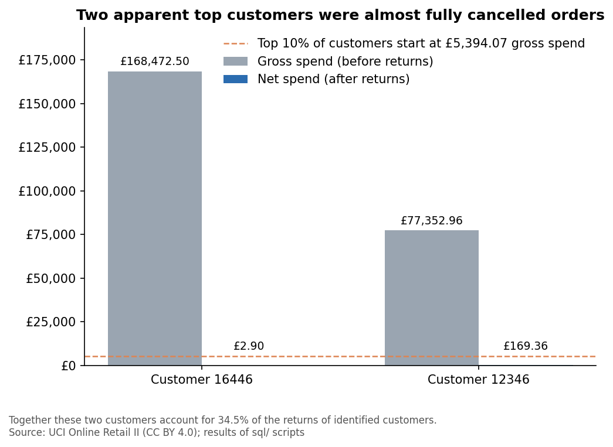
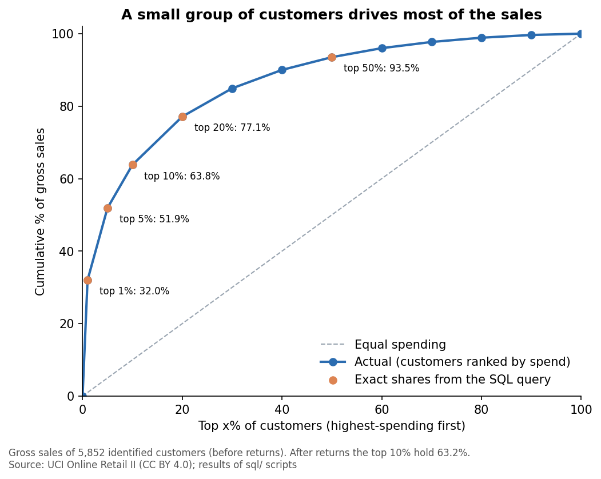

# Customer Retention & Data-Quality Audit of a UK Online Retailer (MySQL)

An end-to-end SQL analysis of 1,067,371 real retail transaction lines: first prove what is in the data, then measure how well customers come back, which customers matter most, and how concentrated the sales are.

## At a glance

| | Result |
|---|---|
| Data | 1,067,371 raw rows become 1,015,148 valid merchandise lines; every row is accounted for |
| Hidden problem | Two worksheets contain the same nine days twice (1,088 invoices; 22,523 rows removed) |
| Retention | 39.5% of genuinely new customers buy again within 3 months, 60.2% within 12 |
| Customers | 27.5% of identified customers (Loyal active) produce 74.7% of net customer value |
| Concentration | The top 10% of identified customers account for 63.8% of their gross sales |
| Validation | 19 of 19 checks pass on a complete rebuild from the raw CSV |

## 1. Business question

**Can this retailer's transaction log be trusted, and if so, how well does it keep customers and how much of its business rests on how few of them?**

Four questions follow from it:

1. What is wrong with the raw data (duplicates, rows that are not sales, returns), and what can be removed with evidence?
2. How many new customers buy again, and how quickly?
3. Which customer groups matter most, and which are drifting away?
4. How concentrated are sales among the top customers?

## 2. Dataset

**Online Retail II**, UCI Machine Learning Repository (Daqing Chen), licence CC BY 4.0. Transactions of a UK-based online retailer from 2009-12-01 to 2011-12-09; many customers are wholesalers.

* 1,067,371 rows in two Excel worksheets (525,461 + 541,910), columns: invoice, stock code, description, quantity, invoice date, price, customer ID, country.
* After cleaning: 1,015,148 valid merchandise lines, of which 788,189 lines belong to **5,852 identified customers**.
* The data is **not** stored in this repository. How to download and convert it: [`data/README.md`](data/README.md).

## 3. Approach and schema

The database is built in layers. Each layer is created from the one before it and reconciled against it, and the raw data is never edited.

```
CSV (with lineage columns source_sheet, source_row)
  -> raw_online_retail      every column as text, exactly as loaded
  -> stg_sales              typed columns and flags; nothing removed
  -> sales_classified       every row kept, or excluded for exactly one reason
       -> views: sales_clean, sales_customers, returns_clean
  -> customer_invoices      one row per invoice of an identified customer
  -> customer_months, customer_cohorts, cohort_retention
  -> customer_rfm_base -> customer_segments
```

**Scripts** (run in order; each header states what it creates and replaces):

| Script | What it does | Creates |
|---|---|---|
| `scripts/convert_to_csv.py` | Converts the workbook to one CSV and adds the lineage columns | CSV (outside the repository) |
| `sql/01_setup_and_load.sql` | Loads the CSV unchanged as text | `raw_online_retail` |
| `sql/02_staging.sql` | Checks formats and builds typed data with flags | `stg_sales` |
| `sql/03_quality_audit.sql` | Measures data-quality problems; investigates duplicates and the overlap | `dup_groups` (helper) |
| `sql/04_clean_views.sql` | Applies the cleaning rules, one classification per row | `overlap_invoices`, `sales_classified`, views `sales_clean`, `sales_customers`, `returns_clean` |
| `sql/05_reconciliation.sql` | Proves nothing was lost or double-counted | (read-only checks) |
| `sql/06_customer_base.sql` | One row per invoice for identified customers | `customer_invoices` |
| `sql/07_cohort_retention.sql` | Monthly cohorts and retention | `customer_months`, `customer_cohorts`, `cohort_retention` |
| `sql/08_rfm_segments.sql` | RFM table, segments, concentration | `customer_rfm_base`, `customer_segments` |
| `sql/09_validation_summary.sql` | Re-checks 19 key numbers in one query | (read-only) |
| `scripts/make_charts.py` | Redraws the charts from `results/` | `images/*.png` |

**Cleaning rules** (each row gets the first rule that applies; evidence and effect in [`docs/decision_log.md`](docs/decision_log.md)):

| # | Rule | Rows |
|---|---|---:|
| 1 | Export duplicate: the worksheet-2 copy of an invoice already in worksheet 1 | 22,523 |
| 2 | Non-merchandise code (postage, fees, adjustments, tests) | 5,712 |
| 3 | Cancellation (kept as returns) | 17,975 |
| 4 | Zero or negative price | 6,013 |
| | **Kept: valid merchandise sales** | **1,015,148** |

**Design choices that matter:**

* **Lineage is stored, not inferred.** The conversion script writes `source_sheet` and `source_row` into the CSV. An early attempt to infer the worksheet from database row order was wrong; a boundary check against the original Excel file caught it.
* **Value is net of returns**, because two almost fully cancelled orders would otherwise count as top customers.
* **Segments are rule-based** (recency 90 and 365 days, frequency 5 invoices), because many customers share the same frequency and tied quintile scores would be arbitrary.

## 4. Key findings

**The most surprising result: two apparent "top customers" were not.** Customers 16446 and 12346 each placed a very large order (£168,472.50 and £77,352.96), which puts both in the top 10% of customers by gross spend. Both orders were almost entirely cancelled, so their net values are **£2.90 and £169.36**. Together they account for 34.5% of the returns of identified customers. Ranking by gross spend would have put two customers worth about £172 combined among the most valuable.



Everything below uses value net of returns unless stated.

* **A few customers carry the business.** Among identified customers, the top 1% (59) account for 32.0% of gross sales, the top 10% for 63.8% and the top 20% for 77.1% (63.2% and 76.7% after returns).



* **Loyal active customers** (bought within 90 days, 5+ invoices) are 27.5% of identified customers but 74.7% of net customer value, and include 512 of the 586 highest-value customers.
* **Retention is irregular.** About 21% of new customers buy in each of the first three months after their first purchase (18% at month 6, 15% at month 9), but among genuinely new customers (July 2010 onward) 39.5% return within 3 months, 48.2% within 6 and 60.2% within 12.
* **Customers at risk:** 405 regular customers have been silent for 91 to 365 days (£1.22M of historical net value), and 70 of the 586 top spenders have not bought for 90 days.

Segments, retention tables, cautions and untested hypotheses for action: [`docs/findings.md`](docs/findings.md). More charts: [`images/`](images/). Result tables: [`results/`](results/).

## 5. Validation checks

The project's numbers can be re-derived and cross-checked in two ways. They answer different questions.

**Layer 1: does the build reproduce the analysis?** `sql/09_validation_summary.sql` runs 19 checks in one query. Each compares a number in the rebuilt database with the value recorded in this analysis. **All 19 pass on a complete rebuild from the raw CSV.** This shows the scripts reproduce the results; it does not by itself show the results are right.

| # | Check | What it verifies | Expected |
|---|---|---|---:|
| 1 | Raw rows loaded | The whole file loaded: no rows lost or duplicated | 1,067,371 |
| 2 | Worksheet 1 rows | The sheet's row count matches the original workbook | 525,461 |
| 3 | Worksheet 2 rows | The sheet's row count matches the original workbook | 541,910 |
| 4 | Staging rows | Converting text to typed columns lost no rows | 1,067,371 |
| 5 | Invoices present in both worksheets | The size of the overlap between the sheets | 1,088 |
| 6 | Excluded: export duplicates | Rule 1 removes the expected number of rows (the worksheet-2 copies) | 22,523 |
| 7 | Excluded: non-merchandise codes | Rule 2 removes the expected number of rows | 5,712 |
| 8 | Excluded: cancellations | Rule 3 separates the expected number of return rows | 17,975 |
| 9 | Excluded: zero or negative price | Rule 4 removes the expected number of rows | 6,013 |
| 10 | Kept: valid merchandise sales | With checks 6 to 9 every raw row is accounted for: 22,523 + 5,712 + 17,975 + 6,013 + 1,015,148 = 1,067,371 | 1,015,148 |
| 11 | Gross line total (GBP) | The sum of quantity times price over all raw rows. It includes returns and fees (negative) and the duplicate copies (positive) | 19,287,250.55 |
| 12 | Kept amount (GBP) | The same sum over kept rows only. See the bridge below | 19,702,710.61 |
| 13 | Identified customers | The customer population is the one analysed | 5,852 |
| 14 | Invoices of identified customers | The invoice table has the expected number of invoices (its lines and amount are tied to the kept sales in `06_customer_base.sql`) | 36,594 |
| 15 | Customers assigned to a cohort | Only the 28 customers who first bought in the partial last month are left out | 5,824 |
| 16 | Monthly cohorts | The retention grid covers December 2009 to November 2011 | 24 |
| 17 | Customers in segments | Every customer is in exactly one segment | 5,852 |
| 18 | Net customer value (GBP) | Gross customer value minus returns (17,124,940.98 minus 711,640.12) | 16,413,300.86 |
| 19 | Top 10% share of gross sales (%) | The headline concentration figure reproduces | 63.8 |

**Why check 12 is larger than check 11.** The kept amount is the largest figure because the gross line total also contains negative amounts (returns and fees) and the positive amount of the duplicate copies. The bridge, in GBP:

| | Amount |
|---|---:|
| Kept amount (check 12) | 19,702,710.61 |
| Less returns (cancellations) | -719,762.50 |
| Less non-merchandise (net: postage in, fees and adjustments out) | -73,186.01 |
| Plus export duplicate copies | +377,488.45 |
| **Gross line total (check 11)** | **19,287,250.55** |

**Layer 2: independent evidence behind the decisions** (`sql/05_reconciliation.sql`, `sql/03_quality_audit.sql`):

* A **line-by-line proof of the worksheet overlap**: all 22,202 distinct lines of the 1,088 overlapping invoices appear the same number of times in both sheets (0 mismatches), and no rows lie outside the overlap window.
* **Audit counts carried through every category** (cancellations, zero prices, missing IDs and missing descriptions each add up to the raw total).
* **Invoice consistency:** no kept invoice has several customers or countries.

## 6. How to run it

1. **Prerequisites:** MySQL 8.0 or later, MySQL Workbench, Python 3 with `pandas` and `openpyxl`.
2. **Get and convert the data** following [`data/README.md`](data/README.md). The conversion script adds the lineage columns.
3. **Workbench settings:** in the connection's *Advanced* tab add `OPT_LOCAL_INFILE=1` under *Others*; under *Edit > Preferences > SQL Editor* raise *DBMS connection read timeout* to 600 seconds (several queries scan over a million rows).
4. **Build:** edit the CSV path in `sql/01_setup_and_load.sql`, then run scripts 01, 02, 04, 06, 07 and 08 in order (*File > Open SQL Script*, then the lightning-bolt button).
5. **Verify:** run `sql/09_validation_summary.sql` as a single statement; all 19 rows should show PASS.
6. **Optional:** run the statements of `03_quality_audit.sql` and `05_reconciliation.sql` one at a time (click inside, Ctrl+Enter) and compare them with the expected values in their comments. `scripts/make_charts.py` redraws the charts from `results/`.

Developed on MySQL 8.0.45 for Windows with MySQL Workbench.

## 7. What I would improve

* **Test the segment thresholds.** The cut-offs (90 days, 365 days, 5 invoices) are justified by the data but I have not measured how much the segments change if they move.
* **Show uncertainty.** Retention is descriptive; small cohorts (72 to 125 customers) need confidence intervals before they are compared.
* **Decide the repeated lines properly.** 11,731 identical lines inside invoices (£57,092.82, 0.29% of kept sales value) are kept because they might be repeated scans. Only the business could confirm.
* **Fix the data capture.** 13.1% of kept sales value (22.4% of kept lines) has no customer ID, and returns cannot be matched to the purchase they reverse. Both need changes at the source, not in SQL.
* **Cover more time.** Two years contain only one full seasonal cycle, so seasonal effects cannot be separated from customer behaviour.
* **Add a dashboard** for non-technical readers, and **run the whole build with one command** instead of by hand.
* **Limitations that remain:** one retailer with many wholesale customers; early 2010 cohorts include existing customers; December 2011 is a partial month; amounts are in GBP and not inflation-adjusted.

## Attribution and licence

Chen, D. *Online Retail II* [Dataset]. UCI Machine Learning Repository. https://archive.ics.uci.edu/dataset/502/online+retail+ii. Licensed under CC BY 4.0. This repository is released under the MIT licence (see `LICENSE`).
