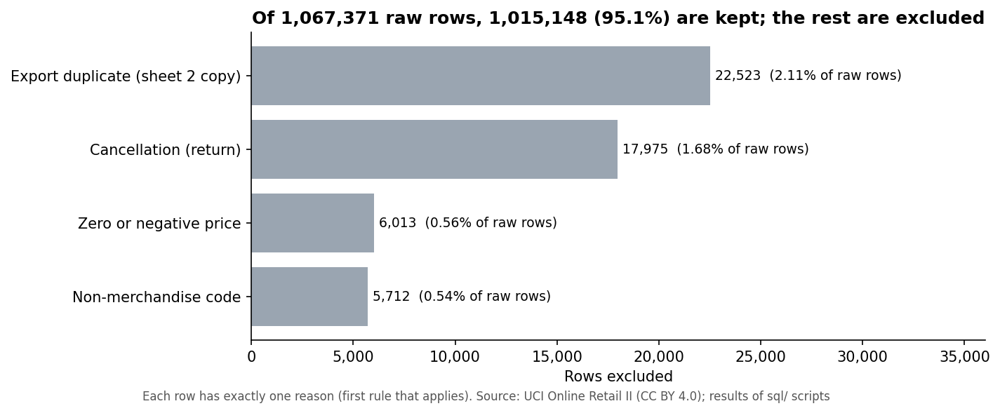
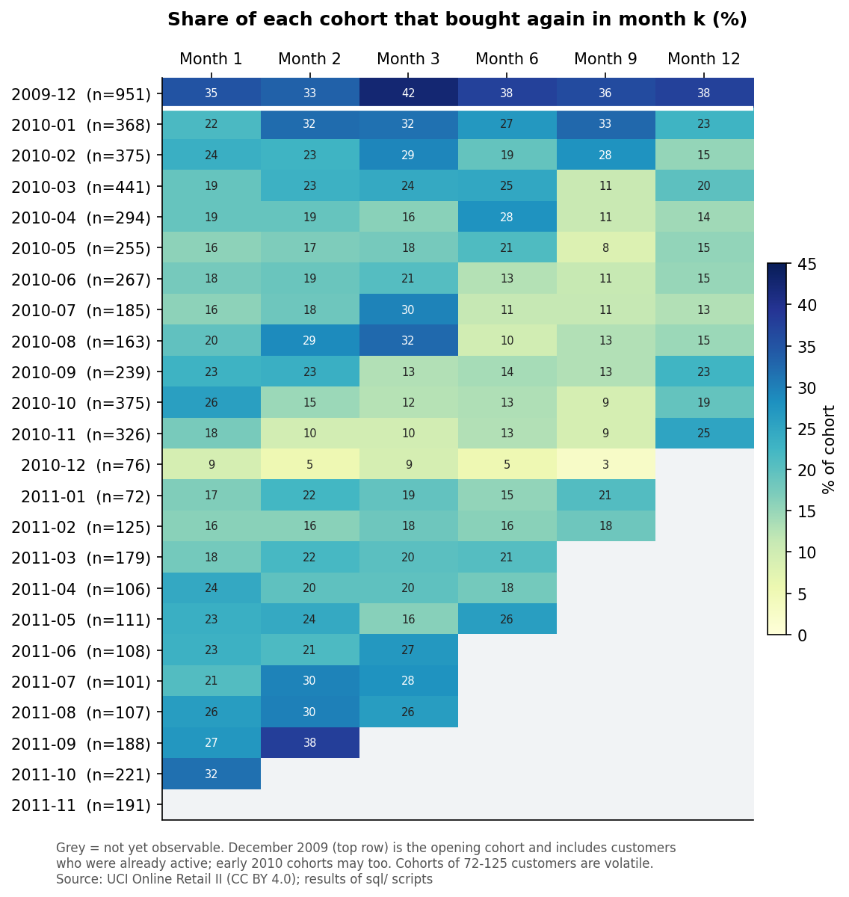
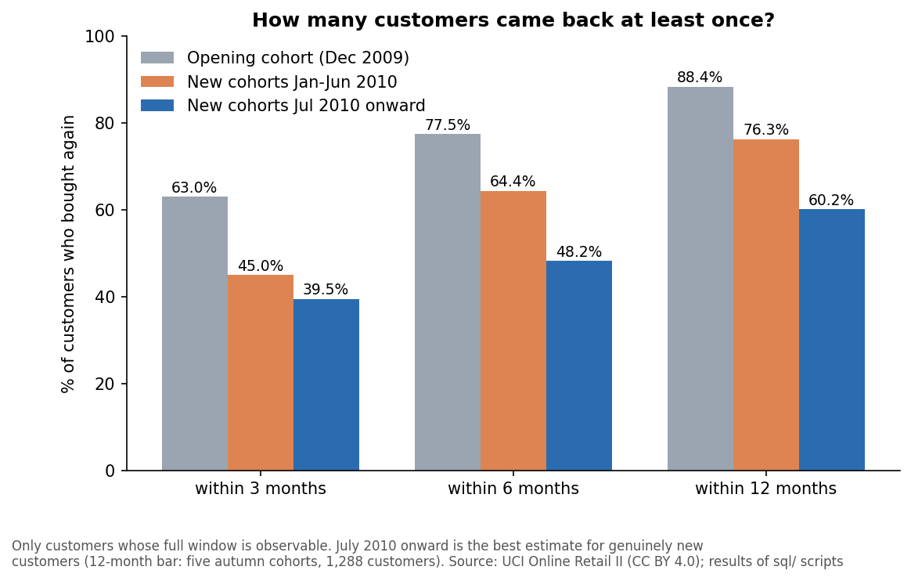
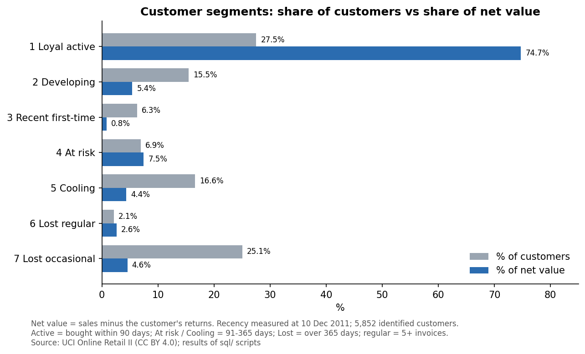

# Customer Retention & Data-Quality Audit of a UK Online Retailer (MySQL)

> **Status:** complete. Data audit, cleaning and reconciliation, cohort retention, RFM segmentation and revenue
> concentration are finished and validated.

## Summary

A UK online retailer's two-year transaction log (1,067,371 rows) looks like a ready-made sales table, but it is not:
two Excel worksheets export the same nine days twice, fees and postage sit among the product sales, returns are mixed in,
and two large orders were almost entirely cancelled. This project loads the data into MySQL, proves each problem, removes only
what it can justify, and reconciles every row (1,015,148 valid merchandise lines remain). On that foundation it measures how
well customers come back, segments them, and shows how much of the business rests on a few customers.

* About **one new customer in five** buys in any given month, and about **40% come back within three months** (60% within twelve).
* **27.5% of customers (Loyal active) produce 74.7% of net customer value**, including 512 of the 586 highest spenders.
* The **top 10% of customers hold 63.8% of sales**; the top 1% (59 customers) alone hold 32.0%.
* **70 of the 586 top spenders have not bought for 90 days or more**, and 405 regular customers are drifting away (£1.22M of historical value).

What the project demonstrates: MySQL 8 (CTEs, window functions, a recursive CTE), data-quality auditing with row-level
reconciliation, duplicate investigation, cohort analysis, RFM segmentation, and honest reporting of limitations. Python is
used only for conversion and charts.

## Key results

### Data quality: every row is accounted for



| Finding | Result |
|---|---|
| Rows loaded (two worksheets) | 1,067,371 (525,461 + 541,910); worksheet lineage checked against the original Excel file |
| Worksheet overlap | 1,088 invoices appear in both sheets as exact copies (1-9 Dec 2010); 22,523 rows removed |
| Missing Customer ID | 243,007 rows (22.77%) |
| Reconciliation | 22,523 export copies + 5,712 non-merchandise + 17,975 cancellations + 6,013 zero-price + 1,015,148 kept = 1,067,371 |

Rules, evidence and effect of each cleaning decision: [`docs/decision_log.md`](docs/decision_log.md).

### Retention: customers come back, but irregularly





Early 2010 cohorts look better than they probably are (they include existing customers), so the best estimate for genuinely
new customers comes from the July 2010 onward cohorts: 39.5% return within 3 months, 48.2% within 6 and 60.2% within 12.

### Segments and concentration




Value is measured net of returns, because two almost fully cancelled orders (customers 16446 and 12346) make up 34.5% of all
customer returns. Segment definitions, results and untested hypotheses for action: [`docs/findings.md`](docs/findings.md).

## How the data is protected from silent errors

* **Lineage is stored, not inferred.** The conversion script writes `source_sheet` and `source_row` into the CSV.
* **Raw data is never edited.** It is loaded as text, typed into a staging table, then classified.
* **One reason per row.** Every row is either kept or excluded for exactly one documented reason.
* **Every layer reconciles to the one before it,** with expected values written in the scripts and re-checked by one query
  (`sql/09_validation_summary.sql`).

## Dataset

**Online Retail II**, UCI Machine Learning Repository (Daqing Chen), CC BY 4.0. Transactions of a UK-based online
retailer from 2009-12-01 to 2011-12-09; many customers are wholesalers. Acquisition and conversion steps are in
[`data/README.md`](data/README.md). The data is not stored in this repository.

## Scripts

Run the SQL scripts in order. Each header states what it creates and what it replaces.

| Script | Purpose | Creates |
|---|---|---|
| `scripts/convert_to_csv.py` | Convert the workbook to one CSV with lineage columns | CSV (outside the repository) |
| `sql/01_setup_and_load.sql` | Load the CSV unchanged into a text table | `raw_online_retail` |
| `sql/02_staging.sql` | Validate formats and build a typed table | `stg_sales` |
| `sql/03_quality_audit.sql` | Measure data-quality problems; investigate duplicates and the overlap | `dup_groups` (helper) |
| `sql/04_clean_views.sql` | Apply the cleaning rules, one classification per row | `overlap_invoices`, `sales_classified`, views `sales_clean`, `sales_customers`, `returns_clean` |
| `sql/05_reconciliation.sql` | Prove nothing was lost or double-counted | (read-only checks) |
| `sql/06_customer_base.sql` | One row per invoice for identified customers | `customer_invoices` |
| `sql/07_cohort_retention.sql` | Monthly cohorts and retention | `customer_months`, `customer_cohorts`, `cohort_retention` |
| `sql/08_rfm_segments.sql` | RFM table, segments, concentration | `customer_rfm_base`, `customer_segments` |
| `sql/09_validation_summary.sql` | One query that re-checks 19 key numbers (all should show PASS) | (read-only) |
| `scripts/make_charts.py` | Redraw the charts from `results/` (needs `pandas`, `matplotlib`) | `images/*.png` |

## How to reproduce

1. **Prerequisites:** MySQL 8.0 or later, MySQL Workbench, Python 3 with `pandas` and `openpyxl`.
2. **Get and convert the data** following [`data/README.md`](data/README.md).
3. **Workbench settings:** in the connection's *Advanced* tab, add `OPT_LOCAL_INFILE=1` under *Others*; under
   *Edit > Preferences > SQL Editor*, raise *DBMS connection read timeout* to 600 seconds (several queries scan over a
   million rows).
4. **Build:** edit the CSV path in `sql/01_setup_and_load.sql`, then run scripts 01, 02, 04, 06, 07 and 08 in order
   (*File > Open SQL Script*, then the lightning-bolt button). Scripts 03 and 05 are the audit and reconciliation checks;
   run their statements one at a time (click inside, Ctrl+Enter) and compare them with the "Expected" values in the comments.
5. **Verify:** run `sql/09_validation_summary.sql`; every row should show PASS.

Developed on MySQL 8.0.45 for Windows with MySQL Workbench.

## Repository structure

```
README.md
LICENSE
data/README.md          source, licence, how to obtain and convert the data
scripts/                convert_to_csv.py, make_charts.py
sql/                    numbered SQL scripts (run in order)
results/                validated result tables copied from the queries (see results/README.md)
docs/decision_log.md    cleaning rules, definitions, evidence, reconciliation
docs/findings.md        data-quality and customer findings, hypotheses, limits
images/                 charts
```

## Limitations

* One retailer over two years; many wholesale customers, so behaviour may differ from typical consumer retail.
* 13.1% of kept sales have no Customer ID and cannot be followed over time.
* Returns cannot be matched to the original purchase; value uses net sales per customer.
* The first month (December 2009) and the early 2010 cohorts include customers who were already active; December 2011 is a partial month.
* Retention and segments are descriptive snapshots, not forecasts; the recommendations in `docs/findings.md` are untested hypotheses.
* Amounts are in GBP and not adjusted for inflation.

## Attribution

Chen, D. *Online Retail II* [Dataset]. UCI Machine Learning Repository.
https://archive.ics.uci.edu/dataset/502/online+retail+ii. Licensed under CC BY 4.0.
This repository is released under the MIT licence (see `LICENSE`).
